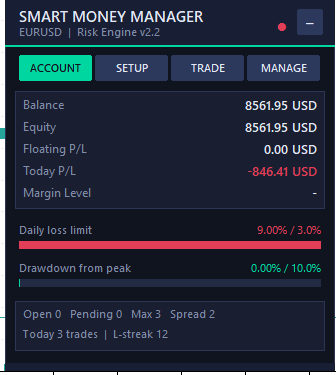
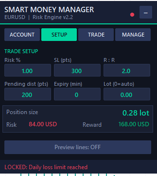
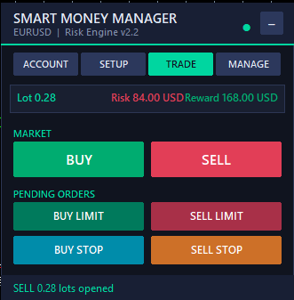
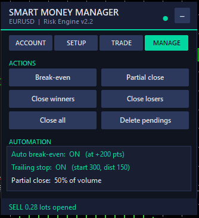

# 🛡️ MQL5 Risk Manager

**A modern, tabbed trade-management panel for MetaTrader 5.**
Risk-based position sizing · market & pending orders · on-chart SL/TP preview · account protection · trade automation.

**English** · [فارسی](README.fa.md)

<table>
  <tr>
    <td align="center"></td>
    <td align="center"></td>
    <td align="center"></td>
    <td align="center"></td>
  </tr>
  <tr>
    <td align="center"><b>ACCOUNT</b> live stats &amp; limit bars</td>
    <td align="center"><b>SETUP</b> risk, SL, R:R &amp; sizing</td>
    <td align="center"><b>TRADE</b> market &amp; pending orders</td>
    <td align="center"><b>MANAGE</b> BE, partial &amp; close tools</td>
  </tr>
</table>

---

## ✨ What is this?

**Smart Money Manager** is an Expert Advisor that does **not** trade by itself. You decide the direction and the level; the EA takes care of everything that usually blows accounts up: **position sizing, stop-loss placement, protection limits and trade management**, all from a dark, compact panel on your chart.

> One panel. Every trade sized by risk. Every limit enforced.

## 🚀 Features

### Execution
- **Risk-% lot sizing** from balance, stop-loss distance and the symbol's tick value (or a fixed lot override)
- **Market orders:** BUY / SELL
- **Pending orders:** Buy Limit, Sell Limit, Buy Stop, Sell Stop with configurable distance and expiry
- SL and TP are set automatically from your **SL (points)** and **R:R** values
- Free-margin check before every order

### 👁️ Live chart preview
Cycle the preview button and see **entry, SL and TP lines with lot size and money risk/reward** on the chart *before* you click.

### 🧱 Account protection
| Guard | What it does |
|---|---|
| Daily loss limit | Locks trading at X % loss of the day-start balance |
| Daily profit target | Locks trading once the target is reached |
| Max drawdown | Locks at X % equity drawdown from the peak |
| Loss streak | Locks after N consecutive losing closes today |
| Max trades per day | Caps the number of trades opened today |
| Max positions | Caps open positions **+** pending orders |
| Max open risk | Caps the total SL-implied risk of everything open |

Choose how a limit reacts: **Alert only**, **Block new orders**, or **Block + close all + delete pendings**.

### 🧭 Filters
- Trading-hours window (broker server time, supports overnight windows)
- Max spread
- **News filter** using the built-in MT5 economic calendar (High or Medium + High impact, minutes before/after)

### ⚙️ Trade management
- Auto **break-even** and **trailing stop**
- **Partial close** (% of volume)
- Close all · Close winners · Close losers · Delete pendings

### 🔔 Notifications
Pop-up alerts and optional push notifications to your phone when a limit is hit.

### 🖥️ Interface
Four tabs keep the panel short: **ACCOUNT · SETUP · TRADE · MANAGE**. The header has a minimize button; protection keeps running while minimized.

## 📦 Installation

1. In MetaTrader 5 open **File → Open Data Folder**.
2. Copy `MQL5/Experts/Smart_Money_Manager.mq5` into your data folder's `MQL5/Experts/`.
3. Open **MetaEditor** (`F4`) and compile the file (`F7`).
4. Drag **Smart_Money_Manager** onto a chart and enable **Algo Trading**.
5. The news filter uses the terminal's built-in economic calendar, so no WebRequest / URL whitelist setup is needed.

> ⚠️ Always test on a **demo account** first.

## 🎛️ Usage

1. **SETUP** tab: set *Risk %*, *SL (pts)* and *R:R*. The position size and the money at risk update instantly.
2. Turn on **Preview lines** to see entry / SL / TP on the chart.
3. **TRADE** tab: press BUY, SELL or one of the four pending buttons.
4. **MANAGE** tab: break-even, partial close, close winners/losers, close all, delete pendings.
5. **ACCOUNT** tab: watch balance, equity, daily-loss and drawdown bars.

## 🔧 Inputs

<b>Show all inputs</b>

| Group | Input | Default | Description |
|---|---|---|---|
| Risk | `InpRiskPercent` | 1.0 | Risk per trade, % of balance |
| Risk | `InpSLPoints` | 300 | Stop loss in points |
| Risk | `InpRR` | 2.0 | Reward : Risk (0 = no TP) |
| Risk | `InpFixedLot` | 0.0 | Fixed lot (0 = auto from risk %) |
| Pending | `InpEntryDistance` | 200 | Pending distance from price (points) |
| Pending | `InpExpiryMinutes` | 0 | Pending expiry in minutes (0 = GTC) |
| Limits | `InpMaxDailyLossPct` | 3.0 | Daily loss limit, % of day-start balance |
| Limits | `InpMaxDailyProfitPct` | 0.0 | Daily profit target lock, % |
| Limits | `InpMaxDrawdownPct` | 10.0 | Max equity drawdown from peak, % |
| Limits | `InpMaxLossStreak` | 0 | Lock after N consecutive losses today |
| Limits | `InpMaxTradesPerDay` | 0 | Max trades opened per day |
| Limits | `InpMaxPositions` | 3 | Max open positions + pending orders |
| Limits | `InpMaxOpenRiskPct` | 0.0 | Max total open risk, % of balance |
| Limits | `InpLockAction` | Block | Alert only / Block new orders / Hard lock |
| Filters | `InpUseHours` | false | Enable trading-hours filter |
| Filters | `InpStartHour` / `InpEndHour` | 8 / 20 | Window in server time |
| Filters | `InpMaxSpread` | 0 | Max spread in points (0 = off) |
| Filters | `InpNewsLevel` | Off | Off / High / Medium + High |
| Filters | `InpNewsBefore` / `InpNewsAfter` | 30 / 30 | Block minutes around news |
| Management | `InpUseBE` | true | Auto break-even |
| Management | `InpBETrigger` / `InpBEOffset` | 200 / 20 | Trigger and offset (points) |
| Management | `InpUseTrail` | true | Auto trailing stop |
| Management | `InpTrailStart` / `InpTrailDist` / `InpTrailStep` | 300 / 150 / 20 | Trailing parameters (points) |
| Management | `InpPartialPct` | 50 | Partial close, % of volume |
| Notify | `InpPopupAlerts` / `InpPushAlerts` | true / false | Alerts |
| General | `InpMagic` | 20260512 | Magic number |
| General | `InpSlippage` | 20 | Max slippage (points) |
| General | `InpManageAllMagic` | false | Manage trades of all magics on this symbol |
| General | `InpPanelX` / `InpPanelY` | 15 / 25 | Panel position |

Set any limit to `0` to disable it.

## ⚠️ Notes & limitations

- The EA guards orders **placed from its panel**. Orders opened by hand in the terminal or by other EAs are not blocked, but *Hard lock* will close/delete everything it manages.
- By default only trades with this EA's **magic number** are managed. Enable `InpManageAllMagic` to manage all trades on the symbol.
- The drawdown peak is tracked from when the EA starts; it resets if the EA is restarted.
- "Daily" statistics use the broker's server-day (midnight server time).
- The news filter needs the terminal's economic calendar to be available on your broker/account.
- Panel text is in English (MT5 does not render right-to-left text reliably on charts).

## 🛠️ Roadmap

- [ ] Per-prop-firm presets (FTMO, The5ers…)
- [ ] Weekly / monthly limits
- [ ] Partial take-profit levels (TP1 / TP2 / TP3)
- [ ] Light theme
- [ ] Hotkeys

Contributions and ideas are welcome: open an issue or a pull request.

## 📜 Disclaimer

Trading leveraged products carries a high level of risk and may not be suitable for everyone. This software is a risk-management **utility**, not investment advice and not a profit guarantee. Use it at your own risk; the authors are not liable for any losses.

## 📄 License

[MIT](LICENSE)
